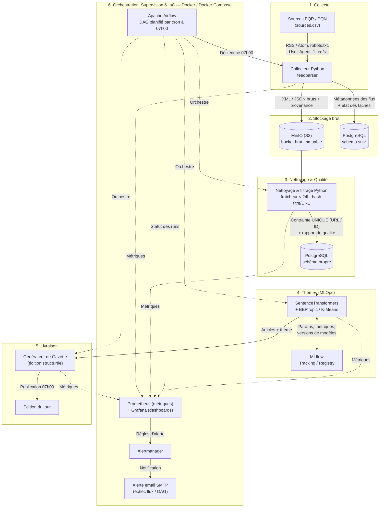

# Note de Cadrage — Projet M2Ops « La Gazette »

## 1. Reformulation du besoin

Le projet « La Gazette » consiste à concevoir, déployer et maintenir un pipeline de données automatisé et autonome. Chaque matin, le système doit interroger la presse quotidienne régionale (PQR) et nationale (PQN), collecter les métadonnées de l'actualité récente, écarter les éléments non pertinents, regrouper les articles par grandes thématiques et publier de façon autonome une édition quotidienne à 7 h du matin.

L'enjeu principal du projet ne réside pas uniquement dans le développement fonctionnel, mais dans la démarche M2Ops : garantir la fiabilité du pipeline, son observabilité, son automatisation complète et sa capacité à tourner sans intervention humaine quotidienne.

---

## 2. Périmètre et bornage strict

### Périmètre inclus (*In Scope*)

* **Données collectées :** Titres, extraits (résumés/chapeaux), liens URL, dates de publication et rubriques/catégories.

* **Sources :** Au moins 4 titres de la PQR et 4 titres de la PQN documentés dans le fichier `sources.csv`.

* **Fraîcheur :** Traitement exclusif des articles publiés au cours des dernières 24 heures.

* **Livrable automatisé :** Génération et publication autonome de l'édition de 7 h regroupée par thèmes.

### Périmètre exclus (*Out of Scope*)

* **Aspiration intégrale :** Interdiction stricte de récupérer le texte intégral des articles.

* **Médias et interactions :** Interdiction d'aspirer les images, vidéos ou espaces de commentaires.

* **Données personnelles :** Aucune collecte de profils, de données d'abonnés ou de suivi d'audience.

* **Génération par LLM :** Pas de résumé automatique par Modèles de Langage (LLM).

---

## 3. Contraintes du projet

* **Horaires et fraîcheur :** Publication quotidienne fixe à 07 h 00 avec des articles de moins de 24 h de fraîcheur.

* **Budget :** Budget financier strictement égal à zéro. Le développement tourne sur les machines de l'équipe au démarrage en attendant la mise à disposition de l'infrastructure de production (fournie par l'école Efrei).

* **Conformité légale :** Respect du fichier `robots.txt` et des conditions générales d'utilisation de chaque éditeur de presse.

---

## 4. Schéma d'architecture globale

Le pipeline s'articule autour des 6 boîtes fonctionnelles du projet. L'ensemble tourne dans des conteneurs décrits par Docker Compose, orchestrés par Airflow et supervisés par Prometheus / Grafana.

---

## 5. Étude comparative et choix de la stack technique

### 5.1 Boîte 1 : Récupérer la presse (Collecte)

* **Option A (Retenue) — Parsing de flux RSS / Atom via `feedparser` (Python) :**
* *Pourquoi :* Données structurées par nature (XML), garantit techniquement de ne pas aspirer le texte intégral, respecte les serveurs des éditeurs.

* **Option B (Écartée) — Scraping HTML via `BeautifulSoup` / `Playwright` :**
* *Raisons du rejet :* Risque d'aspiration accidentelle de contenu protégé ou de données personnelles, instabilité face aux changements de structure des sites web.

* **Politesse applicative :** Définition d'un `User-Agent` identifiant l'équipe et espacement d'au moins 1 seconde entre les requêtes.

### 5.2 Boîte 2 : Faire tourner chaque matin (Ordonnancement & Execution)

* **Option A (Retenue) —  Apache Airflow :**
* *Pourquoi :* Planifie le pipeline à 7 h avec cron, organise les tâches dans un DAG et permet de suivre les exécutions et les erreurs.

* **Option B (Écartée) — Prefect :**
* *Raisons du rejet :* Outil similaire, mais Airflow est retenu pour sa gestion des DAG et son interface de supervision. Utiliser les deux serait redondant.

### 5.3 Boîte 3 : Stocker (Brut et Propre)

**Stockage Brut :**  
  
* *Option A (Retenue) — MinIO (S3) + PostgreSQL :*
* *Pourquoi :* MinIO (S3) stocke les fichiers flux bruts (les fichiers XML/JSON d'origine récupérés des flux RSS) dans un bucket sécurisé, garantissant une traçabilité immuable. PostgreSQL enregistre les métadonnées de chaque flux ingéré et l'état des tâches pour le suivi d'exécution.
 
* *Option B (Écartée) — Base NoSQL (MongoDB) :*
* *Raisons du rejet :* Complexité d'administration inutile pour le volume initial.
 
 
**Stockage Propre (Analytique / Application) :**  
  
* *Option A (Retenue) — Base relationnelle PostgreSQL :*
*Pourquoi :* Validation stricte du schéma, requêtage SQL puissant pour filtrer par thématiques ou départements franciliens, et prévention native des doublons via des contraintes d'unicité (ex: contrainte UNIQUE sur l'URL ou l'ID de l'article).
 
* *Option B (Écartée) — Fichiers CSV nettoyés :*
* *Raisons du rejet :* Pas de vérification d'intégrité ni de gestion efficace des doublons.

### 5.4 Boîte 4 : Regrouper des textes (MLOps & Thèmes)

* **Option A (Retenue) — Vectorisation `SentenceTransformers` + Clustering `BERTopic` / `K-Means` + Tracing `MLflow` :**
* *Pourquoi :* Approche NLP non supervisée adaptée au regroupement par thématiques sans génération. MLflow permet de tracer et versionner chaque exécution.

* **Option B (Écartée) — Résumé et classification par LLM (API externe) :**
* *Raisons du rejet :* Explicitement hors sujet selon le cahier des charges, coûts d'API potentiels (violant le budget zéro).

### 5.5 Boîte 5 : Surveiller (Observabilité)

* **Option A (Retenue) — Prometheus + Alertmanager + Grafana :**
* *Pourquoi :* Prometheus collecte et historise les métriques du pipeline, Alertmanager route les alertes par email (SMTP), tandis que Grafana fournit des tableaux de bord pour suivre les exécutions, leur durée, les erreurs de collecte et les volumes d'articles traités. Cette stack open source s'intègre à Docker Compose et pourra être reprise dans l'environnement de production.

* **Option B (Écartée) — Logging structuré JSON + Webhooks de notifications (Discord/Slack) + Dashboard HTML :**
* *Note :* les alertes passent par email via Alertmanager, pas par webhook Discord/Slack.
* *Raisons du rejet :* Cette solution fournit un suivi moins centralisé et moins adapté à l'historisation et à la visualisation des métriques que Prometheus et Grafana.

### 5.6 Boîte 6 : Décrire l'infrastructure en code (IaC)

* **Option A (Retenue) — Docker & Docker Compose :**
* *Pourquoi :* Garantit l'environnement de dev reproductible dès le TD 2, socle indispensable avant le déploiement en production.

* **Option B (Écartée) — Scripts Bash d'installation manuelle :**
* *Raisons du rejet :* Non reproductible d'une machine à l'autre, contraire aux principes M2Ops.

---

## 6. Analyse des risques et mitigations

| Risque identifié | Impact | Probabilité | Mitigation retenue |
| --- | --- | --- | --- |
| **Changement/Indisponibilité d'un flux RSS** | Élevé | Moyenne | Traitement des erreurs HTTP avec retries, journalisation dans l'observabilité et alerte par email (Alertmanager).|
| **Panne ou retard d'exécution de l'ordonnanceur à 7 h** | Élevé | Faible | Notification automatique d'échec et procédure de relance manuelle décrite dans le runbook.|
| **Présence d'articles doublons entre sources** | Moyen | Élevée | Hachage du titre/URL lors du passage au stockage propre pour filtrer les réimpressions.|
| **Changement de format XML (champs manquants)** | Moyen | Moyenne | Règles de contrôle qualité écartant les items incomplets et générant un rapport.|

---

## 7. Rôles et organisation au sein de l'équipe

L'équipe est composée de 4 membres. La responsabilité d'exploitation sera tournante pour la tenue du journal de bord (`docs/journal.md`).

* **Membre 1 — Lead Ingestion & Collecte :** Responsable de la brique *Collecte* et du maintien de `sources.csv`.

* **Membre 2 — Lead Data & Quality :** Responsable des briques *Stockage brut* et *Nettoyage/Qualité*.

* **Membre 3 — Lead MLOps & Clustering :** Responsable de la brique *Thèmes* et du suivi MLflow.

* **Membre 4 — Lead DevOps, IaC & Supervision :** Responsable du socle conteneurisé, de la *Livraison* et de la *Supervision*.